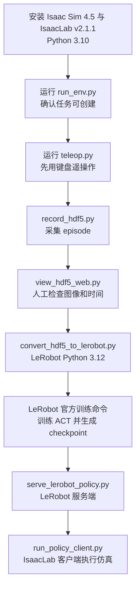

# 初学者复现与代码阅读路线

本文按当前 `stage_6` 工作树说明。目标是先跑通仿真和数据链路，再理解策略推理；Isaac Sim、IsaacLab、LeRobot、数据集和 checkpoint 都是独立安装或准备的内容，仓库本身不包含这些大型依赖与训练产物。

## 总体路线



## 环境准备

当前代码按 Isaac Sim 4.5、IsaacLab v2.1.1 和 Python 3.10 的组合组织。LeRobot 0.5.1 要求 Python 3.12，因此仿真与 LeRobot 操作应放在两个环境中。IsaacLab 的安装步骤应跟随对应版本的官方安装页，不要把最新版 IsaacLab 与本仓库的旧版接口混装。

先准备：

- Ubuntu 22.04、NVIDIA 驱动和能运行 Isaac Sim 的 NVIDIA GPU。
- Isaac Sim 4.5 二进制安装。
- IsaacLab `v2.1.1` 源码，放在仓库的 `dependencies/IsaacLab` 路径；该目录由 Git 忽略，不会随本仓库克隆。
- Python 3.10 的 IsaacLab 环境，以及独立的 Python 3.12 LeRobot 环境。
- LeRobot 0.5.1；训练所用的数据集和 checkpoint 需要自行准备。

官方安装参考：

- [IsaacLab v2.1.1 二进制安装](https://isaac-sim.github.io/IsaacLab/v2.1.1/source/setup/installation/binaries_installation.html)
- [IsaacLab v2.1.1 Quickstart](https://isaac-sim.github.io/IsaacLab/v2.1.0/source/setup/quickstart.html)
- [LeRobot v0.5.1 发布说明](https://github.com/huggingface/lerobot/releases/tag/v0.5.1)

准备好 Isaac Sim 和 IsaacLab 后，在项目根目录安装本项目包：

```bash
cd /path/to/learn_vla
python -m pip install -e . --no-deps
export LWH_ISAAC_SIM_ROOT=/path/to/isaac-sim
export LWH_ISAAC_PYTHON=/path/to/python3.10
```

`LWH_ISAAC_SIM_ROOT` 指向同时包含 `kit/` 和 `apps/` 的 Isaac Sim 安装目录。`LWH_ISAAC_PYTHON` 指向已装好 IsaacLab 依赖的 Python 3.10 解释器。也可以按 `scripts/isaac_runtime.py` 中的查找规则使用 `ISAAC_PATH` 或当前 Python，但显式设置更容易复现。

LeRobot 环境单独安装与本仓库转换、推理脚本相符的版本：

```bash
conda create -n lerobot05 python=3.12 -y
conda activate lerobot05
python -m pip install "lerobot==0.5.1"
```

策略服务还需要 gRPC 运行依赖。安装时以本地 LeRobot 0.5.1 环境的依赖解析结果为准；不要把 Python 3.12 的 LeRobot 包导入 Isaac 的 Python 3.10 进程。

## 逐步复现

### 1. 先启动场景

```bash
python scripts/run_env.py --task Lwh-SO101-Table-v0 --num_envs 1
```

确认机器人、桌面、可抓取物体和相机能出现。若启动失败，先检查 Isaac Sim 根目录、IsaacLab 源码路径、Python 解释器和 USD 文件，不要先排查遥操作或模型。

### 2. 用键盘控制仿真

```bash
python scripts/teleop.py --task Lwh-SO101-Table-v0 --num_envs 1 --camera_mode dual
```

先验证键盘模式，不需要真实机械臂。掌握 `B` 开始、`R` 失败重置、`N` 成功重置后，再研究 Leader 串口模式。

### 3. 录制一小段数据

```bash
python scripts/teleop.py --record --task Lwh-SO101-Table-v0 --num_envs 1 --camera_mode dual --output datasets/hdf5/demo.hdf5
```

按 `B` 开始 episode，用 `R` 或 `N` 结束当前 episode；未正常结束的 episode 会按录制器规则处理。第一次只录很短的一条成功数据，避免一开始就制造大量难以检查的数据。

### 4. 检查录制结果

```bash
python scripts/view_hdf5_web.py --file datasets/hdf5/demo.hdf5
```

先确认相机画面、关节顺序、动作曲线、时间戳和 episode 数量。网页查看器只检查数据，不启动 IsaacSim。

### 5. 转成 LeRobotDataset

在 `lerobot05` 环境执行：

```bash
python scripts/convert_hdf5_to_lerobot.py \
  --input datasets/hdf5/demo.hdf5 \
  --repo_id lwh/so101_demo \
  --output_dir datasets/lerobot/so101_demo
```

转换后再用 LeRobotDataset API 检查 features、图像尺寸、动作维度、FPS 和 episode 数量。仓库没有自定义 ACT 训练入口；训练由 LeRobot 0.5.1 提供，训练参数应按该版本的官方文档配置。

### 6. 启动本地策略推理

终端一，在 `lerobot05` 环境启动服务端：

```bash
python scripts/serve_lerobot_policy.py --host 127.0.0.1 --port 8080 --fps 30
```

终端二，在 Isaac Python 3.10 环境启动客户端：

```bash
python scripts/run_policy_client.py \
  --local_policy_server \
  --task Lwh-SO101-Table-v0 \
  --server_address 127.0.0.1:8080 \
  --policy_path /path/to/act_checkpoint \
  --policy_type act \
  --policy_device cpu \
  --actions_per_chunk 30 \
  --chunk_size_threshold 0.5
```

这里的 checkpoint 必须先由 LeRobot 训练得到。客户端只控制 IsaacLab 仿真，不连接真实 follower。远程服务器模式是在此基础上增加 SSH 隧道和远程地址配置。

## 推荐源码阅读顺序

按下面顺序读，可以沿着一条动作从入口追到仿真结果：

| 顺序 | 文件 | 阅读目标 |
|---:|---|---|
| 1 | `scripts/run_env.py` | 看入口如何启动 Isaac、注册任务、创建环境并循环 `env.step()`。 |
| 2 | `source/lwh_isaaclab_tasks/lwh_isaaclab_tasks/__init__.py` | 看导入包时怎样触发 Gym 任务注册。 |
| 3 | `tasks/so101_table/__init__.py` | 看 task id 如何绑定到环境配置类。 |
| 4 | `assets/so101_constants.py`、`assets/so101.py` | 先记住六关节顺序，再看 USD、初始状态和执行器配置。 |
| 5 | `tasks/so101_table/so101_table_env_cfg.py` | 看场景、相机、action、observation、reset 如何组装。 |
| 6 | `tasks/so101_table/mdp.py` | 回头看配置里引用的观测、重置和状态辅助函数。 |
| 7 | `devices/so101_keyboard.py` | 看按键事件如何形成末端增量，再交给环境动作预处理。 |
| 8 | `scripts/teleop.py` | 把入口、设备和环境主循环连起来。重点跟 `teleop.advance()` 到 `env.step(action)`。 |
| 9 | `scripts/record_hdf5.py` | 看 episode 生命周期、每帧数据结构、HDF5 写入与成功/失败标记。 |
| 10 | `scripts/view_hdf5_web.py` | 看浏览器如何读取 HDF5、选择 episode 和显示帧。它很长，先从 `HDF5Catalog`、HTTP handler 和前端入口读。 |
| 11 | `scripts/convert_hdf5_to_lerobot.py` | 看 HDF5 字段怎样映射成 LeRobot features 和 frame。 |
| 12 | `devices/so101_leader.py`、`scripts/calibrate_so101.py` | 最后再看串口寄存器读取、标定文件和 Leader 到仿真关节映射。 |
| 13 | `scripts/serve_lerobot_policy.py` | 看服务端如何接收配置与 observation，并调用 LeRobot PolicyServer。 |
| 14 | `policy/async_client.py` | 看 gRPC、线程、观测队列、action chunk 队列和动作融合。 |
| 15 | `policy/transport/services.proto` | 看协议接口；`services_pb2*.py` 是生成代码，理解协议后浏览接口即可。 |
| 16 | `scripts/run_policy_client.py` | 最后追完整推理闭环：启动仿真、拼 observation、异步收 action、按频率执行。 |

`assets/banana.py` 和 `assets/props/` 是场景可抓取物体及其视觉资源。`configs/so101_leader_calibration.json` 是 Leader 电机映射的运行参数，不是 Python 逻辑。

## 如何读每个模块

每次只追一个输入到输出，不要从文件第一行试图一次看懂全部实现：

1. 找 `main()`、被调用函数或类的 `advance()`。
2. 写下输入是什么，例如键盘事件、相机张量、关节状态或 HDF5 group。
3. 找输出是什么，例如 action、observation 字典、文件字段或 gRPC 消息。
4. 用 `rg` 搜索输出变量名，继续追到下一个模块。
5. 实际运行最小命令，并观察打印、窗口或生成文件是否符合预期。

本仓库的 Python 源文件已在关键流程旁增加中文解释性注释。注释解释职责、数据流和容易误解的分支；Python 关键字、简单赋值等可直接从语法看懂的行不逐行重复翻译。`services_pb2.py` 和 `services_pb2_grpc.py` 由 protobuf 工具生成，修改协议时应改 `.proto` 并重新生成，而不是手工加逐行注释。
